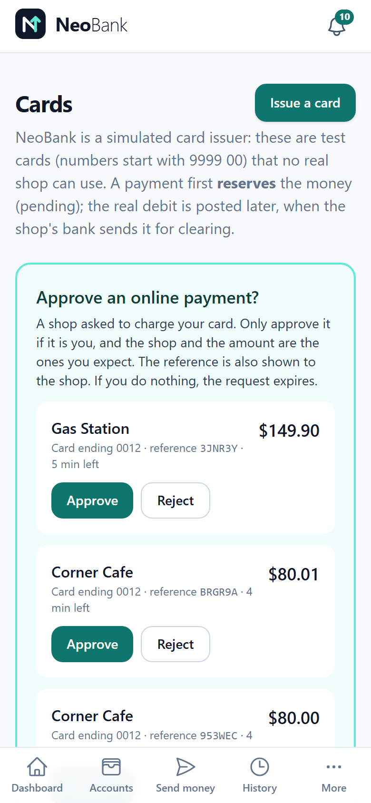
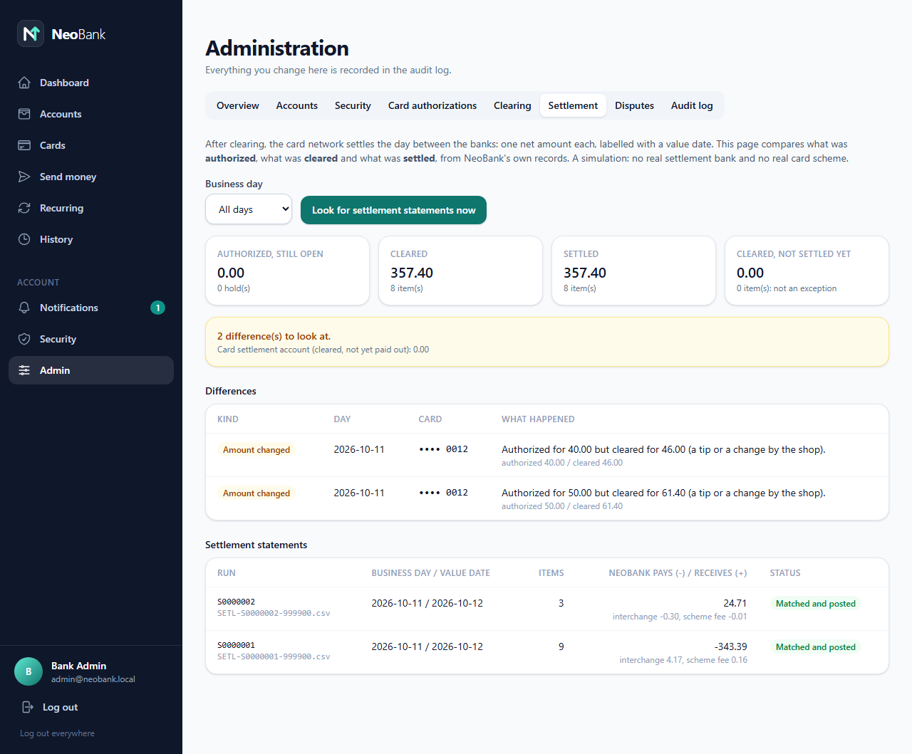
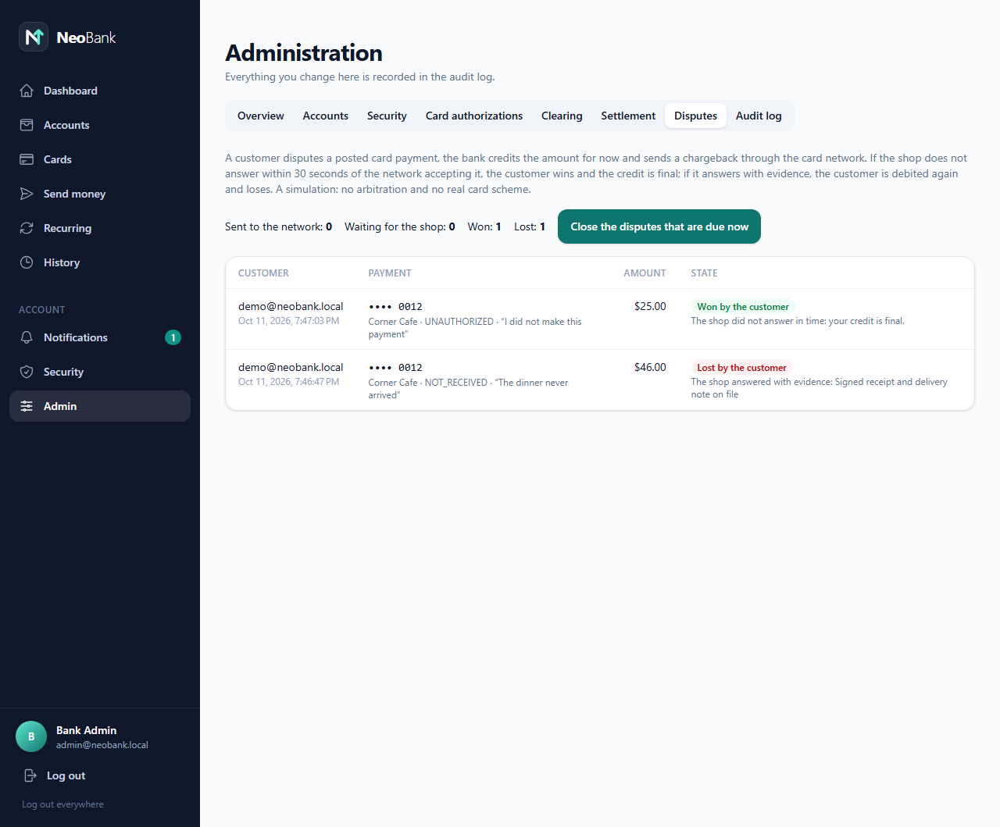

<h1 align="center">NeoBank web app</h1>

<p align="center">
  <strong>The customer's bank and the bank's back office</strong>, for a simulated card-issuing bank.<br>
  Accounts, transfers, a spending dashboard, <strong>cards</strong>, and the admin pages for clearing, settlement and disputes.
</p>

<p align="center">
  <a href="https://github.com/bilalkarakira/neobank-frontend/actions/workflows/ci.yml"></a>
  
  
  
  
  
</p>

This is the **frontend** of NeoBank, a learning and portfolio project that follows **one card payment** from a shop's terminal to a
bank's ledger and on to the settlement between banks. The API, the card network, the virtual shop terminal and the whole
demo stack are in the companion repository [**neobank-backend**](https://github.com/bilalkarakira/neobank-backend), which also explains the
project in depth (what it simulates, how a payment travels, the project plan and its limits). Everything here uses test cards only:
no real money, no real card scheme.

**Contents:**
[What the app is](#what-the-app-is) ·
[Tour of the pages](#tour-of-the-pages) ·
[Tech stack](#tech-stack) ·
[How it is built](#how-it-is-built) ·
[Run it](#run-it) ·
[Tests and build](#tests-and-build) ·
[Docker](#docker) ·
[Security notes](#security-notes) ·
[Known limits](#known-limits)

## What the app is

One Angular application with two faces:

- **For the customer**: open checking and savings accounts, deposit, send money, search the history, watch a dashboard of income
  and spending, schedule recurring payments, and manage **cards**: issue a test card, freeze it, set its daily limit, see what is
  *reserved* and what is *posted*, dispute a payment, and **approve or reject online payments** that wait for the customer's answer.
- **For the bank's staff** (the admin): an overview, accounts and customers, security controls, card authorizations, **clearing**,
  **settlement and reconciliation**, **disputes**, and an audit trail of everything an administrator changed.

Card payments themselves are made somewhere else: in the virtual shop terminal of the backend repository. This app is where the
customer sees the result: a payment first appears as a **pending hold** (the money is reserved), and when the shop's bank clears the
day it becomes **posted**.

## Tour of the pages

**Dashboard**: total balance, income and spending against last month, a balance-over-time chart, income against spending, and spending
by category. Every chart is an image with a text alternative and has a **table view** with the same numbers.

<p align="center"></p>

**Cards**: the card, available balance against reserved money, the day's spending against the limit, pending and posted payments, and
the requests from online shops that wait for **the customer's approval** (the page checks for new ones every five seconds while it is open).

<p align="center"></p>

The same page works on a phone:

<p align="center"></p>

**Admin, settlement and reconciliation**: compares what was authorized, what was cleared and what was settled, from the bank's own
records, explains each difference (for example a tip that changed an amount), and shows the settlement statements the network sent.

<p align="center"></p>

**Admin, disputes**: a customer's chargebacks and how each ended (won because the shop did not answer in time, or lost because it
answered with evidence).

<p align="center"></p>

| Route | Page |
|---|---|
| `/login`, `/register` | sign in and sign up (only for visitors who are not signed in) |
| `/dashboard` | the spending dashboard (the start page) |
| `/home` | accounts: open, deposit, balances, reserved money |
| `/transfer` | send money with a recipient lookup, a review step and retry-safe requests |
| `/recurring` | recurring payments |
| `/history` | filter, sort and page through transactions, export to CSV |
| `/cards` | cards, holds, posted payments, disputes, online payments waiting for approval |
| `/notifications` | new device logins, a card frozen after wrong PINs, requests to approve an online payment |
| `/security` | change the password, see and end sessions |
| `/admin` | the bank's staff: overview, accounts, security, card authorizations, clearing, settlement, disputes, audit log |

## Tech stack

| Area | What is used |
|---|---|
| **Framework** | **Angular 22** with standalone components, **signals** for state, the new control flow (`@if`, `@for`), reactive forms |
| **Language** | **TypeScript 6**, with extra compiler checks on (`noImplicitOverride`, `noImplicitReturns`, `noFallthroughCasesInSwitch`, `noPropertyAccessFromIndexSignature`) and Angular's strict injection and input checks |
| **Styling** | **Tailwind CSS 4** through PostCSS; a light theme, mobile first |
| **Charts** | **Chart.js 4**, created through one small component with an injectable factory (so tests need no real canvas) |
| **HTTP and async** | Angular's `HttpClient` with functional interceptors, **RxJS 7** |
| **Testing** | **Vitest 5** with **jsdom**, Angular's `HttpTestingController`, run through `ng test` |
| **Tooling** | Angular CLI 22 (the application builder, esbuild), Prettier, npm |
| **Packaging** | a multi-stage **Dockerfile**: Node builds the app, **nginx** serves it and passes `/api` on to the backend |
| **CI** | GitHub Actions: install exactly as locked (`npm ci`), run every test, make the production build, build the Docker image |

## How it is built

- **Feature folders.** `src/app/features/<area>/` holds a page, its service, its models and its tests together; `core/auth` holds
  what every page shares. 17 components, 35 test files.
- **Lazy routes and guards.** Every page is loaded on demand. `authGuard`, `guestGuard` and `adminGuard` decide who may open what.
- **One refresh for many failures.** When several calls fail at once because the short-lived access token expired, the interceptor
  makes **one** refresh request, then repeats every failed call, and survives the refresh cookie rotating.
- **Retry-safe money actions.** Deposits and transfers send an idempotency key, so a double click or a retry cannot move money twice.
- **Honest numbers.** Amounts stay strings from the API and are formatted for display, never summed as floating point.
- **Accessible by default.** Charts have text alternatives and table views, forms have labels and error messages, and state is not
  carried by colour alone. (A keyboard-only and a screen-reader pass are still on the list.)
- **Everything is tested.** Every page and the auth interceptor have tests, written against the HTTP layer, not against internals.

## Run it

You need **Node.js 22 or newer** (developed with 24). The app talks to the backend's API on port 8080, so start the backend first;
the [backend README](https://github.com/bilalkarakira/neobank-backend#readme) has the whole stack in one command, or each part on its own.

```bash
npm install
npm start          # http://localhost:4200, /api is proxied to http://localhost:8080 (see proxy.conf.json)
```

Log in as the demo customer `demo@neobank.local` / `DemoPassw0rd` (the backend creates it when it starts with the `demo` profile, which
the Docker stack does). The admin is `admin@neobank.local` / `AdminPassw0rd`. The demo card is `9999 0000 0000 0012`, PIN `4321`,
security code `123` (published test values, not secrets).

## Tests and build

```bash
npm test                # Vitest: 412 tests, every page and the auth interceptor
npx ng build            # production build into dist/neobank-frontend/browser
```

Run `npx ng build` as well as the tests: Vitest does not type-check.

## Docker

```bash
docker build -t neobank-frontend .      # nginx image with the production build
```

The image is what the demo stack of the backend repository uses (`deploy/nginx.conf` passes `/api` on to the `neobank` service).
`Dockerfile.prebuilt` packages a build you made yourself, for a faster start while changing code.

## How the project is organised

```
src/app/
  core/auth/      auth service, HTTP interceptor (one refresh for many failing calls), route guards
  features/       auth (login, register), accounts, dashboard, transfer, history, recurring,
                  cards, notifications, account-security, admin
deploy/           nginx configuration used by the Docker image
docs/images/      the screenshots in this README
Dockerfile        multi-stage build: Node builds the app, nginx serves it
```

## Security notes

The access token is kept in memory only. The refresh token is an httpOnly, SameSite=Strict cookie that scripts cannot read, and the calls
that use the cookie send a custom header so that a cross-site request cannot. A reload brings the session back through the cookie.
A card's number, PIN and security code are shown once, when it is issued, and are gone from the page once dismissed.

## Known limits

Light theme only (no dark mode). Looked at in a browser at desktop and phone width; not checked on tablets, with a keyboard only or with
a screen reader. The Cards page asks the backend for waiting approvals every five seconds while the tab is visible; there is no push.

## Author and license

Built by [@bilalkarakira](https://github.com/bilalkarakira) as a learning and portfolio project. No license has been chosen yet, so the
code is shown for reading and evaluation; please ask before reusing it.
